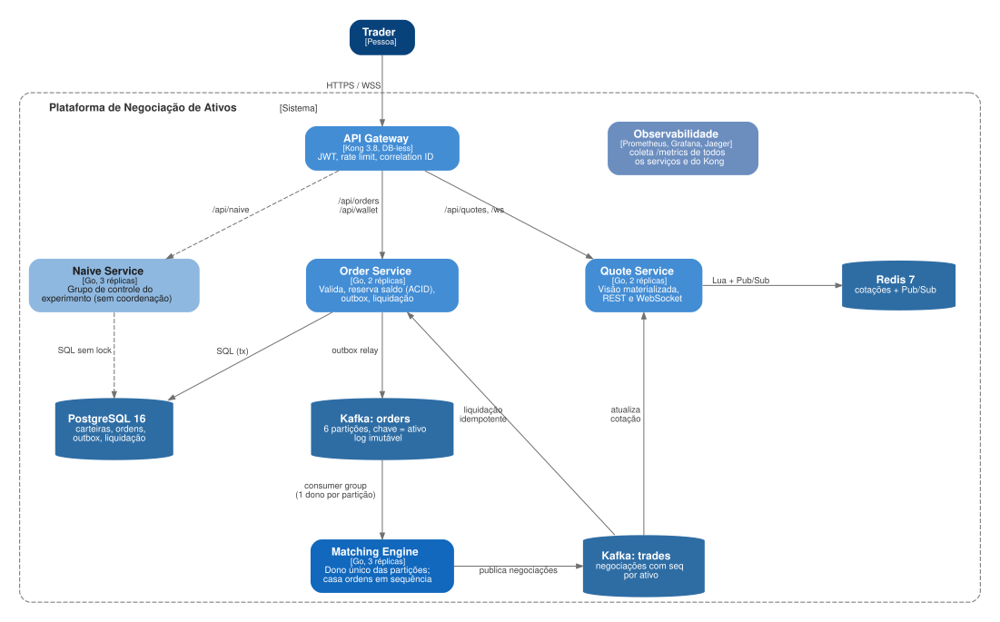

# Plataforma de Negociação de Ativos
 
Projeto Final de Engenharia de Sistemas Distribuídos (2026.2).
 
Plataforma de negociação de ativos (no estilo das exchanges de criptomoedas) em que **cada negociação atualiza o preço do ativo**. O sistema precisa manter um preço correto mesmo recebendo ordens simultâneas do mesmo ativo em servidores diferentes, e explora na prática o dilema **consistência x disponibilidade** (teorema CAP).
 
> Status: **Projeto 02, documentação inicial** (06/11/2026).
 
## Problema
 
Com vários servidores processando ordens do mesmo ativo ao mesmo tempo, surgem:
 
- **Atualização perdida:** duas negociações paralelas leem o mesmo preço e uma sobrescreve a outra.
- **Preços divergentes:** clientes em servidores diferentes veem valores diferentes.
- **Saldo gasto duas vezes:** ordens simultâneas usam o mesmo saldo.
## Decisão central: consistência x disponibilidade
 
| Caminho | Escolha | Como | Custo aceito |
| --- | --- | --- | --- |
| Execução de ordens e preço | Consistência (CP) | Cada ativo tem um único dono: partição do Kafka + *consumer group* ([ADR-001](docs/adr/0001-dono-unico-por-ativo.md)) | Ativo sem execução por alguns segundos durante o failover |
| Saldo das carteiras | Consistência (ACID) | Reserva atômica no PostgreSQL + *Transactional Outbox* ([ADR-003](docs/adr/0003-reserva-acid-e-outbox.md)) | Ordem recusada se o banco estiver fora |
| Consulta de cotações | Disponibilidade (AP) | Visão materializada no Redis + cache local ([ADR-002](docs/adr/0002-cotacoes-eventualmente-consistentes.md)) | Cotação pode chegar alguns ms atrasada |
 
Se o motor dono de um ativo cair, **só os ativos daquela partição** ficam sem execução até o Kafka redistribuí-la. A nova dona reconstrói o livro por replay do log ([ADR-004](docs/adr/0004-replay-deterministico.md)).
 
## Arquitetura
 

 
- [Documento da Entrega 2](docs/ENTREGA-02.md): C4 níveis 1 e 2, stack, padrões, ambiente e responsabilidades.
- [ADRs](docs/adr/): 5 decisões arquiteturais.
- [Diagramas](docs/architecture/): fontes `.dot` (Graphviz) e `.mmd` (Mermaid) e os SVGs gerados.
## Padrões arquiteturais
 
| Padrão | Área |
| --- | --- |
| Database Sharding e Consistent Hashing | Escalabilidade |
| Queues, PubSub e Messaging Fanout | Escalabilidade |
| Strong vs Eventual Consistency | Confiabilidade |
| ACID | Confiabilidade |
| Event Sourcing | Confiabilidade |
| Transactional Outbox | Confiabilidade |
| CQRS e Materialized View | Desempenho |
| Caching e Load Shedding | Desempenho |
| API Gateway (JWT), Rate Limit e Zero Trust | Segurança |
 
Lista completa, com onde cada padrão é aplicado, na seção 5 do [documento da entrega](docs/ENTREGA-02.md).
 
## Stack
 
| Camada | Tecnologia |
| --- | --- |
| Serviços | Go 1.24 |
| API Gateway | Kong 3.8 (DB-less) |
| Eventos e particionamento | Apache Kafka 3.8 (KRaft) |
| Dados | PostgreSQL 16 (carteiras) e Redis 7 (cotações) |
| Tempo real | WebSocket |
| Observabilidade | Prometheus, Grafana e Jaeger |
| Testes | go test, k6 (carga) e Toxiproxy (falhas de rede) |
| Infra | Docker Compose e GitHub Actions |
 
As justificativas estão no [ADR-005](docs/adr/0005-stack-go-kafka-kong.md).
 
## Critérios de sucesso
 
| Critério | Meta |
| --- | --- |
| Zero atualizações perdidas | Preço final igual ao recalculado a partir do log de eventos |
| Comparação com versão ingênua | Versão sem coordenação perde atualizações; a proposta, zero |
| Saldo nunca negativo | 0 carteiras negativas com ordens simultâneas |
| Latência de execução | p95 < 100 ms |
| Vazão | 2.000 ordens/s em 10 ativos |
| Atraso da cotação | p95 < 500 ms até o cliente |
| Custo da consistência | Ativo volta a negociar em < 15 s após queda do seu motor; demais não são afetados |
| Partição de rede | Cotações continuam disponíveis; ordens afetadas ficam pendentes ou são recusadas (503), nunca divergentes |
 
## Como executar
 
Pré-requisitos: Docker com Compose v2.20 ou superior e Go 1.24.
 
```bash
make up      # Kafka, PostgreSQL, Redis, Kong, Prometheus, Grafana e Jaeger
make ps      # todos os containers devem ficar "healthy"
make topics  # tópicos orders e trades com 6 partições
make test    # testes unitários do livro de ofertas
make down
```
 
| Serviço | Endereço |
| --- | --- |
| API Gateway (Kong) | http://localhost:8000 |
| Grafana | http://localhost:3000 |
| Prometheus | http://localhost:9090 |
| Jaeger | http://localhost:16686 |
 
Os serviços da aplicação (`order-service`, `matching-engine`, `quote-service`, `naive-service`) já estão descritos em `compose/app.yml`, no perfil `app`. Eles entram no ambiente com `make up-app` à medida que o código for implementado (Entrega 3).
 
## Estrutura
 
```
docker-compose.yml   inclui os arquivos de compose/
compose/             infra, borda (Kong), observabilidade e aplicação
deploy/              configuração do Kong, Prometheus e Grafana
migrations/          esquema do banco e dados de demonstração
internal/domain      tipos de ordem e negociação
internal/orderbook   livro de ofertas (prioridade preço-tempo) e testes
docs/                documento da entrega, ADRs e diagramas
.github/workflows/   CI (testes, migrations, compose) e segurança
```
## Equipe

| Integrante | GitHub | Responsabilidade |
| --- | --- | --- |
| Georgiana Maria | @georgianagraca | Arquitetura, particionamento e failover |
| Túlio Neiva | @tuliorneiva | Ordens, carteiras e gateway |
| Micael Targino | @MicaelTargino | Cotações, observabilidade e CI |
| Vitor Reis | @Vitoreism | Motor de negociação e testes |

## Ferramentas de IA utilizadas

| Ferramenta | Onde atuou | Como foi orientada |
| --- | --- | --- |
| Claude (Anthropic) | Rascunho da proposta da Entrega 1, rascunho deste documento (C4, ADRs, stack, padrões, roteiro), dos arquivos de ambiente (Compose, CI) e do esqueleto de código | Recebeu o documento de definição do projeto, a proposta da equipe e a descrição do tema |
