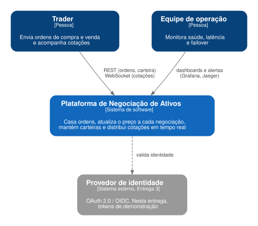
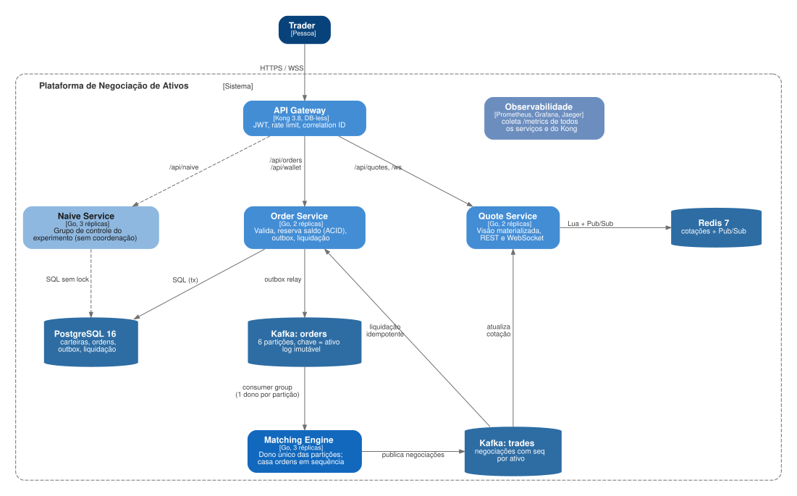

# 1. Itens desta entrega

| Item pedido (seção 2.2) | Onde está |
| --- | --- |
| Diagrama C4 nível 1: contexto | Seção 3.1 · `docs/architecture/c4-context.dot` |
| Diagrama C4 nível 2: containers | Seção 3.2 · `docs/architecture/c4-containers.dot` |
| ADRs iniciais (mínimo 2) | Seção 6 · `docs/adr/` (5 ADRs) |
| Definição do stack tecnológico e justificativas | Seção 4 e ADR-005 |
| Padrões arquiteturais que serão aplicados (mínimo 3) | Seção 5 (12 padrões, 5 áreas técnicas) |
| Setup inicial do ambiente (Docker Compose, CI básico) | Seção 7 e Apêndice A · `docker-compose.yml`, `compose/`, `.github/workflows/` |
| Divisão de responsabilidades | Seção 8 |
| Apresentação (12 a 15 min) | Seção 9 (roteiro) |
| Declaração de uso de IA (obrigatória) | Seção 10 e README |

# 2. Visão geral

A plataforma é uma *exchange* de ativos, no estilo das de criptomoedas: o preço de um ativo é o preço da última negociação, então cada ordem executada muda o preço que a próxima ordem vai ver.

O problema distribuído central é **manter um preço único e correto quando várias réplicas recebem ordens do mesmo ativo ao mesmo tempo**. É o dilema do teorema CAP: diante de falhas, recusar operações para não divergir (consistência) ou aceitar tudo e reconciliar depois (disponibilidade).

A resposta da arquitetura é **não escolher um lado só para o sistema inteiro**:

| Caminho | Escolha | Mecanismo | Custo aceito |
| --- | --- | --- | --- |
| Execução de ordens e preço | **CP** | Um dono por ativo (partição Kafka + consumer group) | Ativo sem execução por alguns segundos durante o failover |
| Saldo das carteiras | **CP (ACID)** | Reserva atômica no PostgreSQL + outbox | Ordem recusada se o banco estiver fora |
| Cotações para os clientes | **AP** | Visão materializada no Redis + cache local | Cotação pode chegar alguns ms atrasada |

# 3. Arquitetura

## 3.1 C4 nível 1: contexto



O sistema tem dois tipos de usuário: o **trader**, que envia ordens e acompanha cotações, e a **equipe de operação**, que acompanha saúde, latência e failover pelos dashboards. A integração com um provedor de identidade OIDC externo está planejada para a Entrega 3.

## 3.2 C4 nível 2: containers



| Container | Tecnologia | Responsabilidade | Estado |
| --- | --- | --- | --- |
| API Gateway | Kong 3.8, DB-less | Ponto único de entrada; valida JWT, aplica rate limit, gera `X-Request-ID`, expõe métricas | Sem estado |
| Order Service | Go, 2 réplicas | Valida ordens, reserva saldo, grava outbox, publica no Kafka, liquida negociações | Sem estado (estado no PostgreSQL) |
| Matching Engine | Go, 3 réplicas | Casa ordens das partições que possui, publica negociações | Livro em memória, reconstruído do log |
| Quote Service | Go, 2 réplicas | Mantém a visão de cotações, serve REST e WebSocket | Cache local descartável |
| Naive Service | Go, 3 réplicas | Grupo de controle do experimento (atualização sem coordenação) | Sem estado |
| PostgreSQL | 16 | Usuários, carteiras, ordens, outbox, negociações liquidadas | Fonte da verdade dos saldos |
| Kafka `orders` | 3.8, 6 partições | Log imutável de ordens, chave = ativo | Fonte da verdade do motor |
| Kafka `trades` | 3.8, 6 partições | Negociações com `seq` por ativo | Log de eventos |
| Redis | 7.4 | Visão materializada das cotações e Pub/Sub | Derivado, reconstruível |
| Observabilidade | Prometheus, Grafana, Jaeger | Métricas de todos os serviços, dashboard provisionado | — |

A infraestrutura (Kafka, PostgreSQL, Redis, Kong e observabilidade) já sobe com o ambiente desta entrega. Os quatro serviços em Go estão declarados no Compose e serão implementados até a Entrega 3.

## 3.3 Fluxo de uma ordem


O cliente recebe `202 Accepted` assim que a ordem e a reserva estão gravadas (passo 6). A execução, a liquidação e a cotação acontecem de forma assíncrona e idempotente.

## 3.4 Failover do motor


Este é o ponto onde a escolha CP aparece: enquanto o grupo rebalanceia, os ativos da partição afetada ficam sem execução. Em troca, a nova dona chega exatamente ao mesmo livro e continua com os mesmos IDs de negociação (ADR-004).

# 4. Stack tecnológico e justificativas

| Camada | Escolha | Justificativa |
| --- | --- | --- |
| Linguagem | **Go 1.24** | Concorrência nativa (goroutines), detector de *race conditions* (`go test -race`), fuzzing embutido, binário estático pequeno e inicialização rápida (importante no failover). |
| Mensageria e log | **Apache Kafka 3.8 (KRaft)** | Ordenação total por partição, *consumer groups* com dono único por partição e retenção infinita: exatamente as garantias dos ADR-001 e ADR-004. RabbitMQ não oferece replay do log nem atribuição exclusiva por chave. |
| Cliente Kafka | **franz-go** | Permite ajustar o offset inicial ao receber uma partição (necessário para o replay), *cooperative sticky rebalance* e commits manuais. |
| Banco transacional | **PostgreSQL 16** | ACID, `CHECK`, `ON CONFLICT` e `SKIP LOCKED` para o outbox. |
| Visão de leitura | **Redis 7** | Scripts Lua atômicos e Pub/Sub para o *fan-out* das cotações. |
| API Gateway | **Kong 3.8 (DB-less)** | Plugins prontos de JWT, *rate limiting*, Prometheus e *correlation ID*. O Traefik OSS não valida JWT sem plugin de terceiros. |
| Observabilidade | **Prometheus, Grafana, Jaeger** | Métricas e dashboard provisionados desde esta entrega; Jaeger pronto para o *tracing* da Entrega 3. |
| Testes | **go test, k6, Toxiproxy** | Unitários, fuzz, integração, carga e injeção de falhas de rede. |
| Entrega | **Docker Compose, GitHub Actions** | Ambiente local reproduzível; CI com testes, validação do ambiente e scan de segurança. Imagens *distroless* e não-root. |

# 5. Padrões arquiteturais

São 12 padrões da seção 5 do documento de definição, cobrindo as 5 áreas técnicas (o mínimo exigido é 3 padrões e 2 áreas).

| Padrão (seção 5) | Área | Onde será aplicado |
| --- | --- | --- |
| Database Sharding Pattern + Consistent Hashing | Escalabilidade | Ordens particionadas pelo hash do código do ativo no tópico `orders` |
| Queues, PubSub e Messaging Fanout | Escalabilidade | Tópicos Kafka; Pub/Sub do Redis para todas as réplicas do Quote Service |
| Stateless, Stateful e Imutabilidade | Escalabilidade | Serviços sem estado; motor com estado derivado de um log imutável |
| Strong vs Eventual Consistency | Confiabilidade | Forte na execução e no saldo; eventual nas cotações (ADR-001, ADR-002) |
| ACID | Confiabilidade | Reserva atômica de saldo com `CHECK (available >= 0)` |
| Transactional Outbox Pattern | Confiabilidade | Ordem, reserva e evento gravados na mesma transação (ADR-003) |
| Event Sourcing | Confiabilidade | Livro de ofertas reconstruído por replay do tópico `orders` (ADR-004) |
| Event Driven Architecture | Confiabilidade | Liquidação e cotações reagem aos eventos do tópico `trades` |
| CQRS + Materialized View | Desempenho | Escrita no motor; leitura na visão de cotações do Redis |
| Caching de dados | Desempenho | Cache local em cada réplica do Quote Service, usado quando o Redis cai |
| Rate Limit / Throttling + Load Shedding | Desempenho | Rate limit no Kong; 503 quando o outbox congestiona; queda de clientes WebSocket lentos |
| API Gateway Pattern + JWT + Zero Trust | Segurança | Kong valida o JWT na borda e o Order Service valida de novo |

**Deployment e DevSecOps:** imagens imutáveis *distroless* e não-root; `govulncheck` e Trivy (dependências, segredos e configuração) rodam a cada push (seção 7.2).

# 6. Architecture Decision Records

| ADR | Decisão | Status |
| --- | --- | --- |
| 001 | Um único dono por ativo para executar ordens (CP na escrita) | Aceito |
| 002 | Cotações com consistência eventual via CQRS (AP na leitura) | Aceito |
| 003 | Reserva de saldo ACID e Transactional Outbox | Aceito |
| 004 | Estado do motor reconstruído por replay determinístico | Aceito |
| 005 | Stack tecnológico | Aceito |

{{ADRS}}

# 7. Setup inicial do ambiente

## 7.1 Docker Compose

O `docker-compose.yml` inclui quatro arquivos da pasta `compose/`, um por camada (o conteúdo completo está no Apêndice A):

| Arquivo | Containers | Sobe por padrão? |
| --- | --- | --- |
| `compose/infra.yml` | Kafka 3.8 (KRaft), criação dos tópicos `orders` e `trades` (6 partições, retenção infinita), PostgreSQL 16 com migrations e dados de demonstração, Redis 7.4 | Sim |
| `compose/edge.yml` | Kong 3.8 DB-less com JWT, rate limit, métricas e `X-Request-ID` (`deploy/kong/kong.yml`) | Sim |
| `compose/observability.yml` | Prometheus (descobre as réplicas pelo DNS do Docker), Grafana com dashboard provisionado, Jaeger | Sim |
| `compose/app.yml` | Order Service (2 réplicas), Matching Engine (3), Quote Service (2), Naive Service (3) | Não: perfil `app`, entra quando o código existir |

```bash
git clone https://github.com/<organizacao>/plataforma-negociacao-ativos.git
cd plataforma-negociacao-ativos
make up       # copia .env.example para .env e sobe o ambiente
make ps       # containers saudáveis
make topics   # orders e trades com 6 partições
```

| Serviço | Endereço |
| --- | --- |
| API Gateway (Kong) | http://localhost:8000 |
| Grafana | http://localhost:3000 |
| Prometheus | http://localhost:9090 |
| Jaeger | http://localhost:16686 |

## 7.2 Integração contínua

Dois workflows do GitHub Actions rodam em todo push na `main` e em todo pull request:

| Workflow | Job | O que faz |
| --- | --- | --- |
| `ci.yml` | build e testes | `gofmt`, `go vet`, testes unitários com detector de *race*, 30 s de fuzz do livro de ofertas, relatório de cobertura |
| `ci.yml` | migrations | Aplica `migrations/001_init.sql` num PostgreSQL 16 de serviço |
| `ci.yml` | ambiente | Valida o Compose, sobe a infraestrutura até ficar saudável e confere os tópicos do Kafka |
| `security.yml` | govulncheck | Vulnerabilidades conhecidas nas dependências Go |
| `security.yml` | trivy | Dependências, segredos e erros de configuração no repositório (também toda segunda-feira) |

Na Entrega 3, o CI ganha o build e o scan das imagens dos serviços, os testes de integração e um *smoke test* ponta a ponta.

# 8. Divisão de responsabilidades

| Integrante | Frente | Nesta entrega | Na Entrega 3 |
| --- | --- | --- | --- |
| Georgiana Maria | Arquitetura, particionamento e failover | C4 níveis 1 e 2, ADR-001, ADR-004, documento da entrega, README | Consumo do Kafka com replay, failover, teste de queda do motor |
| Túlio Neiva | Ordens, carteiras e gateway | Estrutura do repositório, Compose de infraestrutura, migrations, Kong, ADR-003 | Order Service: reserva, outbox, liquidação; autenticação OIDC |
| Micael Targino | Cotações, observabilidade e CI | Workflows de CI e segurança, Compose de observabilidade, Makefile, ADR-002 | Quote Service com Redis e WebSocket; testes de carga com k6 |
| Vitor Reis | Motor de negociação e testes | Tipos de domínio, livro de ofertas com testes, Dockerfile, Compose da aplicação, ADR-005, diagramas de sequência | Matching Engine, experimento naive, testes de integração e de partição |

Todo pull request precisa da aprovação de um integrante de outra frente. A documentação é revisada por todos.

# 9. Roteiro da apresentação (14 minutos)

| Tempo | Quem | Conteúdo | Apoio |
| --- | --- | --- | --- |
| 0:00 a 3:30 | Georgiana Maria | Problema: o preço muda a cada negociação; o que dá errado com várias réplicas; dilema CAP e a divisão CP/AP. C4 níveis 1 e 2 | Seções 2, 3.1 e 3.2 |
| 3:30 a 7:00 | Vitor Reis | Fluxo de uma ordem; livro de ofertas; ADR-004 (replay) e failover; stack (ADR-005) | Seções 3.3, 3.4 e 4 |
| 7:00 a 10:30 | Túlio Neiva | ADR-001 (dono único por ativo) e ADR-003 (reserva ACID e outbox); padrões arquiteturais | Seções 5 e 6 |
| 10:30 a 14:00 | Micael Targino | ADR-002 (cotações AP); demo do ambiente e do CI; divisão de responsabilidades e próximos passos | Seções 7 e 8 |

Reserva de 1 minuto para perguntas dentro do limite de 15.

**Roteiro da demo** (ambiente já no ar; gravar um vídeo de reserva):

1. `make ps`: todos os containers saudáveis.
2. `make topics`: tópicos `orders` e `trades` com 6 partições, a base do dono único por ativo.
3. Abrir o Grafana (dashboard provisionado) e o Prometheus mostrando os alvos.
4. Mostrar no GitHub a última execução verde dos workflows `ci` e `security`.
5. `make test`: testes do livro de ofertas, incluindo prioridade preço-tempo e determinismo.

# 10. Uso de IA

| Ferramenta | Onde atuou | Como foi orientada |
| --- | --- | --- |
| Claude (Anthropic) | Escolha do tema, proposta da Entrega 1, rascunho deste documento (C4, ADRs, stack, padrões, roteiro), dos arquivos de ambiente (Compose, CI) e do esqueleto de código | Recebeu o documento de definição do projeto, a proposta aprovada da equipe e a descrição do tema |

**Avaliação da equipe:** *(a preencher pelo grupo depois da revisão: o que foi mantido, o que precisou ser corrigido, o que foi descartado e por quê)*. A omissão desta seção desclassifica a entrega.
